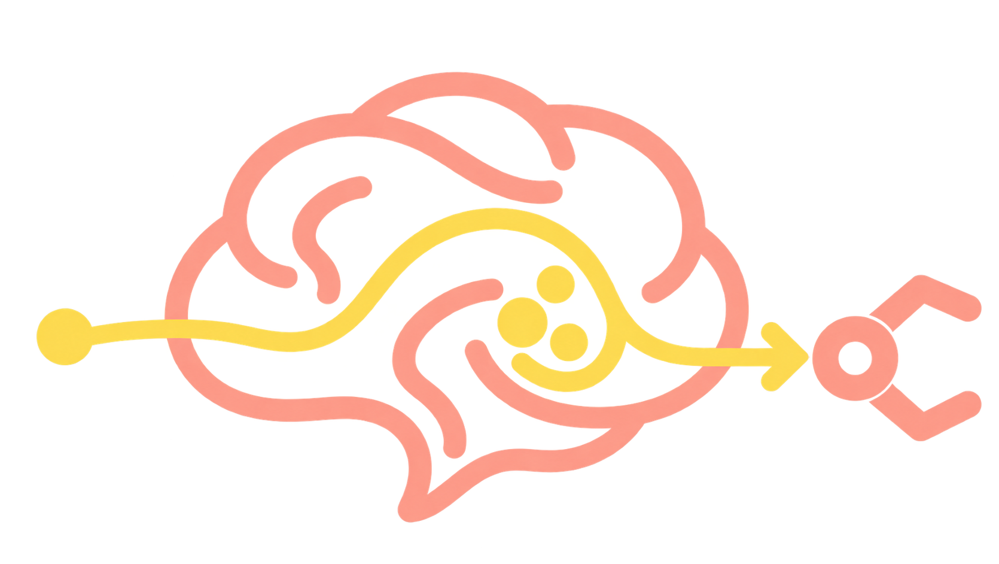
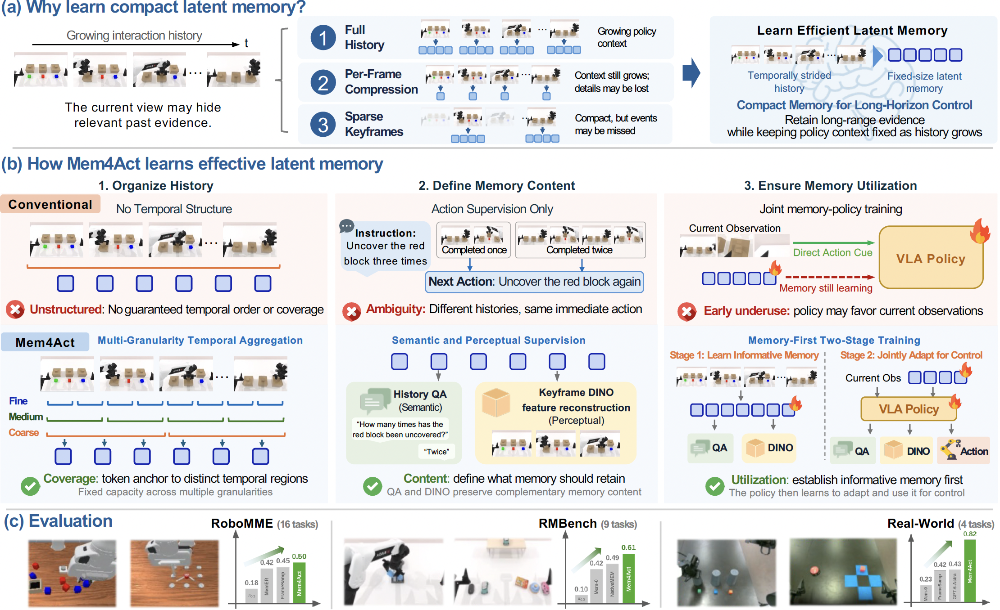
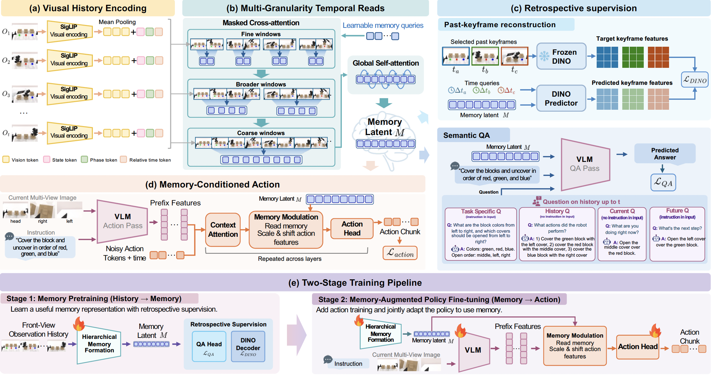
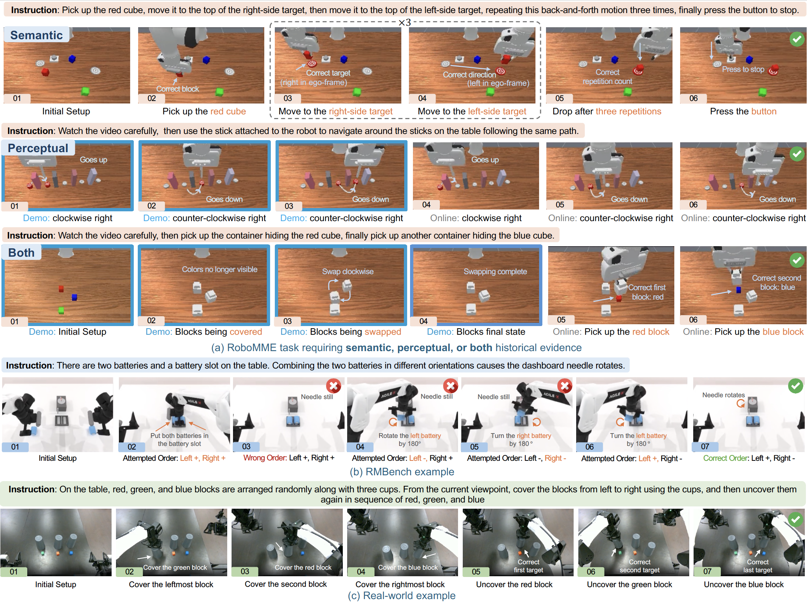

#  Mem4Act

**Mem4Act: Learning Effective Latent Memory for Long-Horizon Robotic Manipulation**

[Yun Zhang](https://handsomeyun.github.io/), [Zhiyu Huang](https://mczhi.github.io/)†, [Tianhui Cai](https://vickycth.github.io/), [Chen Tang](https://chentangmark.github.io/), [Wei Wang](https://web.cs.ucla.edu/~weiwang/), [Jiaqi Ma](https://samueli.ucla.edu/people/jiaqi-ma/)

University of California, Los Angeles (UCLA)  
† Project leader. Corresponding author.

---

## Overview

Long-horizon manipulation hinges on memory. A block's color seen early in a task may be hidden by the time the robot needs it, yet most vision-language-action (VLA) models act from the current observation alone. Existing memory methods store raw history, compressed visual tokens, or language summaries, but they either burden the policy with an ever-growing context or discard the temporal, semantic, and perceptual details that matter later.

Mem4Act continuously distills past observations into a compact, **fixed-size latent memory** trained explicitly for control. **Multi-granularity temporal attention** structures this memory across time scales; **semantic question answering** and **key-frame DINO feature reconstruction** teach it to retain both task facts and fine visual detail; and **memory-first two-stage training** ensures the policy actually draws on memory instead of reacting only to what it currently sees.

Effective latent memory must answer three questions: *where to attend*, *what to retain*, and *how to make the policy use it*.

- 🧠 **Coverage** (where to attend)  
  Multi-granularity temporal attention spreads a limited memory budget across time, merging local events into long-range context rather than repeatedly encoding similar moments.

- 🧩 **Content** (what to retain)  
  Semantic question answering trains memory to keep task-relevant facts, and key-frame DINO feature reconstruction preserves fine visual detail from specific moments, signals that action supervision alone cannot provide.

- 🎯 **Utilization** (how the policy uses it)  
  Memory-first training builds an informative memory with auxiliary supervision before jointly tuning memory and policy for control, so the policy learns to rely on history rather than the current frame alone.

---

## Evaluation

Mem4Act is evaluated across **29 tasks** spanning RoboMME, RMBench, and four real-world setups. It sets a new state of the art for memory-dependent control, while keeping the policy's memory input a fixed size no matter how long the history grows.

- 🤖 **RoboMME (49.88%)**  
  Counting, object permanence, reference, and imitation: accumulate past events, track occluded objects, identify an object from an earlier cue, and reproduce a demonstrated behavior.

- 🧪 **RMBench (61.0%)**  
  Single-observation M(1) tasks, which retain one past observation, and accumulated-memory M(n) tasks, which keep building history over repeated exploration.

- 🦾 **Real world (81.50%)**  
  Cover Blocks, Rearrange Blocks, Swap Blocks, and Put Block Back.

